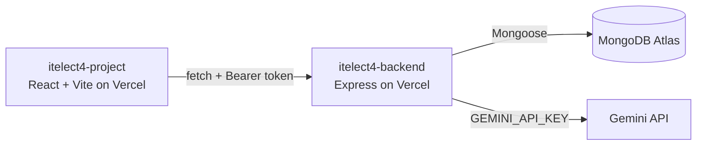

# itelect4-project

[](https://github.com/shin486/itelect4-project/actions/workflows/ci.yml)

The frontend client for the ITELECT4 course submission and AI review portal. Built with React 19, TypeScript, Vite, Tailwind CSS, Shadcn UI, React Hook Form with Zod validation, and TanStack Query.

- **Live Site:** https://itelect4-project-nine.vercel.app
- **Live API:** https://itelect4-backend-tau.vercel.app/api/health
- **Backend repo:** https://github.com/shin486/itelect4-backend

## Architecture



## Features

- User authentication (login/registration) with JWT persistence
- Protected routes requiring authentication
- Course listing and detail pages
- Submission tracker with custom status badge rendering
- AI Review page with Zod schema validation gating submissions
- Dark/light UI modes with Tailwind CSS

## Tech Stack

- **Framework:** React 19 + TypeScript
- **Build Tool & Test Runner:** Vite + Vitest + jsdom + Testing Library
- **Styling:** Tailwind CSS + Shadcn UI
- **Forms & Validation:** React Hook Form + Zod
- **State Management:** Zustand + TanStack Query
- **Routing:** React Router v8
- **CI/CD:** GitHub Actions (Node 24)

## Local Development

```bash
# Install dependencies
npm install

# Configure environment variable
cp .env.example .env
# Set VITE_API_URL=http://localhost:4000 (or your backend address)

# Start dev server
npm run dev

# Run automated tests
npm test

# Run linter
npm run lint

# Build for production
npm run build
```

## Testing

Vitest executes unit and component tests in a jsdom environment:
- `src/components/SubmissionBadge.test.tsx` — verifies prop-based rendering and fallback states.
- `src/hooks/useToggle.test.ts` — tests hook initialization and state transitions with `act()`.
- `src/pages/ReviewPage.test.tsx` — verifies schema validation errors and ensures invalid forms do not trigger network calls.

## AI-Use Disclosure

In accordance with course guidelines, AI coding assistance (Gemini 3.8 / Antigravity) was used for test suite scaffolding, TypeScript type validation, CI workflow syntax alignment, and Markdown architecture documentation. All application logic and test scenarios were reviewed, verified, and executed.
